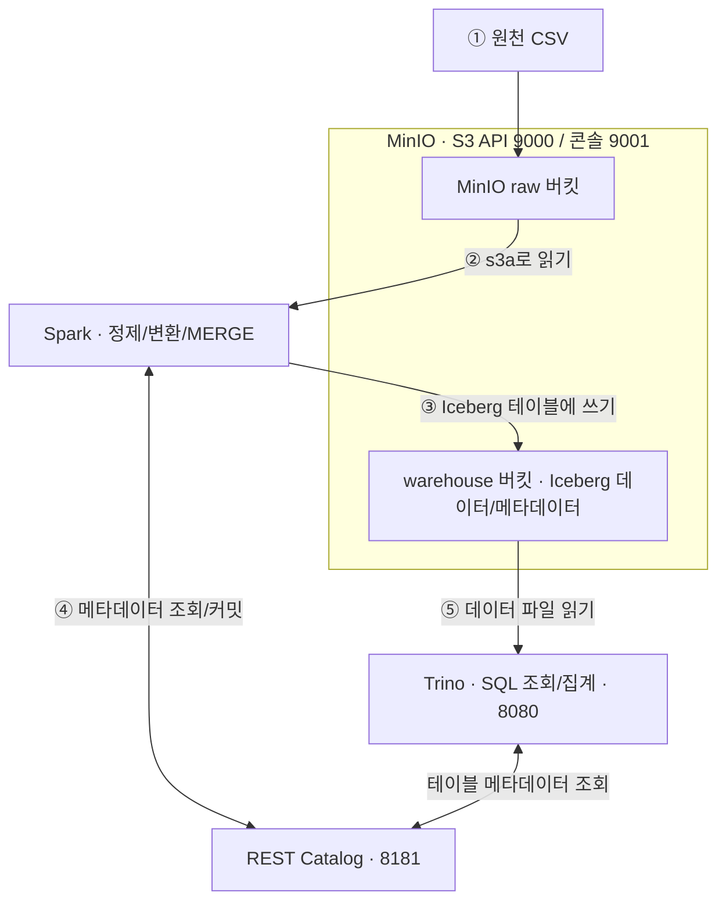

# 4주차 산출물 — 레이크하우스 아키텍처

> 실습 환경: `~/lakehouse` (WSL2 Ubuntu)  
> 확인 기준: 2026-10-22 터미널 출력 및 4-1~4-5 실습 기록

## 1. 구성

| 구성 요소 | 실제 구성 및 역할 | 포트 | 없으면 |
|---|---|---|---|
| MinIO | `minio` 컨테이너, `raw` 원천 데이터와 `warehouse` Iceberg 데이터 저장 | 9000(S3 API), 9001(콘솔) | 공통 데이터 파일을 저장할 오브젝트 스토리지가 없다 |
| Apache Iceberg | `orders`, `daily_sales` 등의 테이블 형식, 스키마·스냅샷·파일 메타데이터 관리 | 별도 포트 없음 | 파일 집합의 현재 상태와 변경 이력을 테이블 단위로 관리하기 어렵다 |
| REST Catalog | `iceberg-rest` 컨테이너, 테이블 이름을 최신 메타데이터 위치에 연결 | 8181 | 두 엔진이 공통 테이블의 현재 메타데이터를 공유하기 어렵다 |
| Spark | `spark-iceberg` 컨테이너, CSV 정제 및 Iceberg 적재(MERGE), 테이블 변경 | 실습 컨테이너 노출 8888 | 이번 실습의 Spark 기반 대량 정제·적재 작업을 수행할 엔진이 없다 |
| Trino | `trino` 컨테이너, Iceberg SQL 조회·집계·INSERT | 8080 | 이번 실습의 Trino 기반 대화형 SQL 분석을 할 수 없다 |
| MinIO Client | `mc` 컨테이너, 버킷·파일 관리 보조 | 외부 노출 포트 없음 | 명령줄에서 MinIO 관리 작업을 하는 방법 하나가 사라진다 |

실제로 `docker compose ps`에서 **5개 컨테이너**(`iceberg-rest`, `mc`, `minio`, `spark-iceberg`, `trino`)가 모두 `Up`이었고 Trino는 `healthy` 상태였다. 위 표의 Iceberg는 별도 컨테이너가 아니라 **테이블 형식**이므로, 구성 기술 5개와 컨테이너 5개는 같은 분류가 아니다.

### 아키텍처 다이어그램



> Iceberg는 저장소나 별도 서버가 아니라 **테이블 형식**이다. Spark·Trino는 카탈로그에서 현재 테이블 메타데이터를 확인하고 MinIO의 실제 파일에 접근한다.

## 2. 데이터 흐름

1. 원천 CSV를 MinIO의 `raw` 버킷에 두어 랜딩 존으로 사용했다.
2. Spark에서 CSV를 읽고 데이터 정제 및 변환을 수행했다. 관련 코드: `scripts/etl_orders.py`, `scripts/etl_bad.py`.
3. 정제 데이터를 Iceberg 테이블에 `MERGE INTO` 방식으로 적재했다. 4-3 실습에서는 추가 데이터를 처리한 뒤 주문 6건을 확인했다.
4. 쓰기 작업이 성공적으로 커밋되면 Iceberg의 최신 테이블 메타데이터가 갱신되고 REST Catalog를 통해 공유된다.
5. Trino가 같은 테이블을 읽어 주문 내역과 고객별·채널별 매출을 분석했다. SQL 모음: `scripts/lakehouse_queries.sql`.

## 3. 실제 검증 결과

### 이번 터미널에서 직접 확인한 현재 상태

| 항목 | 확인 결과 |
|---|---|
| Docker 서비스 | `iceberg-rest`, `mc`, `minio`, `spark-iceberg`, `trino` 모두 Up; Trino healthy |
| 주문 행 수 | Trino `SELECT count(*)` → **7건** |
| `orders` 컬럼 | `order_id` bigint, `customer` varchar, `amount` double, `order_date` date, `channel` varchar, `memo` varchar — **6개** |
| Iceberg 스냅샷 | Trino의 `orders$snapshots` → **13개** |
| Trino 카탈로그 | `iceberg`, `iceberg2`, `system` |
| 카탈로그 설정 파일 | `catalog/iceberg.properties` 및 `catalog/iceberg2.properties` **둘 다 존재** |
| 쿼리 스크립트 | `scripts/lakehouse_queries.sql` 파일 존재 |
| 이 설명 파일 | 제출용으로 별도 작성. **터미널의 `find` 결과에는 아직 없었음** |

### 앞선 실습 로그로 확인한 결과

- Trino에서 `(8, 'jung', 27000, DATE '2026-08-04', 'app')` 주문을 INSERT했고, **6건 → 7건**이 되었다. Spark 조회에서도 8번 주문이 확인되었다.
- Spark에서 `memo` 컬럼을 추가·수정한 뒤, Trino 주문 조회에 **4번 `choi`의 `memo='vip'`**가 나타났다.
- Spark와 Trino에서 조회한 **스냅샷 개수가 각각 13개**로 일치했다. 다만 개수 일치는 모든 스냅샷 ID가 동일하다는 검증과는 구분한다.
- Trino SQL 집계 결과 총 주문 금액은 **192,000원**, 채널별로 `app` **118,000원(61.5%)**, `web` **74,000원(38.5%)**이었다.
- `daily_sales` 조회 결과는 8월 1일 15,000원, 8월 2일 47,000원, 8월 3일 103,000원으로 출력되었다. 따라서 **현재 `orders` 전체 7건의 총액과 `daily_sales`의 합계가 자동 일치하는 구조는 아니다**. 집계 테이블을 별도로 갱신해야 한다.

### 현재 출력만으로 확인되지 않은 항목

- `iceberg`와 `iceberg2`가 각각 7건으로 조회되는지 여부(둘 다 카탈로그 목록에 있는 것까지만 이번 출력으로 확인).
- 잘못된 자료형 INSERT 실패 뒤 건수와 스냅샷이 그대로 유지되었는지 여부.
- `docker compose down` 후 `up -d`로 **직접 재기동**했는지 여부. 현재 서비스들이 8분 전에 생성되어 Up인 것은 확인되지만, 그 자체로 재기동 전후 비교를 증명하지는 않는다.

## 4. 한계와 다음 단계

1. **원천 데이터 재처리 비용:** 랜딩 존 전체를 매번 다시 읽는 방식은 파일이 늘면 비효율적이다. 날짜별 파일/파티션을 기준으로 신규 데이터만 처리하도록 개선할 필요가 있다.
2. **집계 최신성:** `orders`에 새 행이 생겨도 `daily_sales`가 자동 갱신되지 않았다. 원천 테이블과 집계 테이블의 갱신 순서, 검증 로직이 필요하다.
3. **운영 자동화:** 현재 파이프라인을 수동 실행한다. 향후 Airflow 등으로 수집→정제→적재→집계→검증을 순서대로 실행하고 실패 알림을 붙이고 싶다.
4. **임시 설정 정리:** `catalog/iceberg2.properties`가 남아 있으므로 실습 종료 시 필요한 설정인지 판단하고 불필요하면 정리한다.
5. **재현성 점검:** 제출 전 `docker compose down` (**`-v` 사용 금지**) → `docker compose up -d` → 주문 수 7건 확인으로 데이터 유지 여부를 검증한다.

## 5. 주요 프로젝트 파일

```text
~/lakehouse/
├── docker-compose.yml
├── catalog/
│   ├── iceberg.properties
│   └── iceberg2.properties
├── scripts/
│   ├── etl_bad.py
│   ├── etl_orders.py
│   └── lakehouse_queries.sql
├── s3_demo.py
└── lakehouse_architecture.md  # 이 제출 문서
```

`data/`에는 실습 CSV 등이 있으며, `.venv/`는 가상환경이다. GitHub 제출 시에는 개인정보·비밀번호 등이 포함된 설정 파일을 점검하고 `.venv/`와 불필요한 데이터 파일은 제외한다.